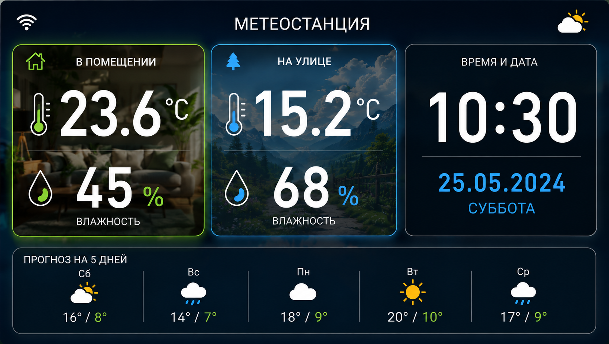
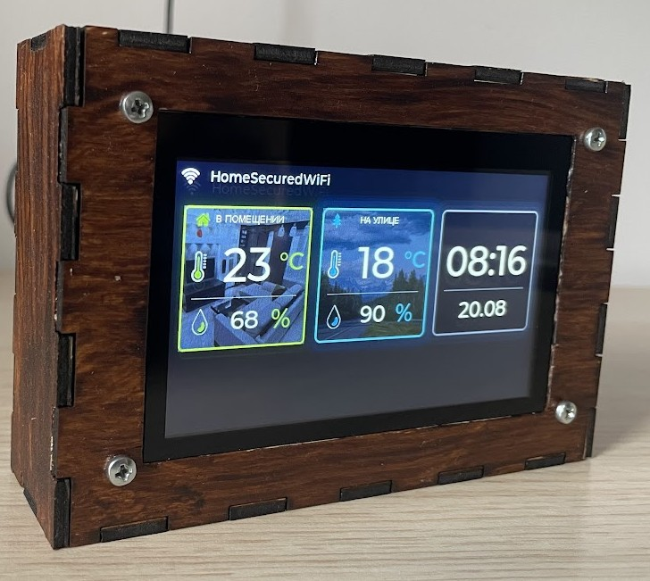
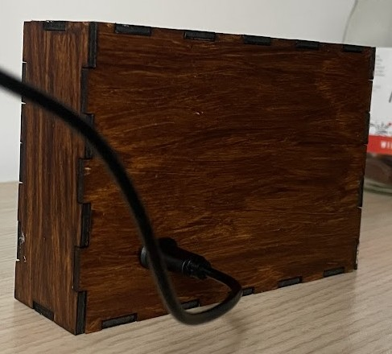

# DYI Whether Station

## Overview

A compact indoor weather station built around an ESP32-S3 (ESP32-4827S043) board with a 4.3-inch display.

The device is designed to provide an at-a-glance overview of the current indoor and outdoor temperature and humidity, along with the current time.

The station connects to the local Wi-Fi network and retrieves weather data through the Tuya Cloud Services API, combining a clean visual interface with real-time environmental data.

## Appearance  

### Interface 

### Built device

## Components

- Development board ESP32-4827S043 with 4.3 inch display and touch screen - [ESP32-4827S043](https://pl.aliexpress.com/item/1005011714889431.html?spm=a2g0o.order_list.order_list_main.5.2cc31c24lK0bAA&gatewayAdapt=glo2pol#nav-specification)
- 2 Zigbee temperature Sensors - [Zigbee Temperature Sensor](https://pl.aliexpress.com/item/1005010706930293.html?spm=a2g0o.productlist.main.5.61001379Y7DAIl&algo_pvid=251ee909-bdf0-43f2-a05d-8ff2b2eff0e7&algo_exp_id=251ee909-bdf0-43f2-a05d-8ff2b2eff0e7-4&pdp_ext_f=%7B%22order%22%3A%2210118%22%2C%22eval%22%3A%221%22%2C%22orig_sl_item_id%22%3A%221005010706930293%22%2C%22orig_item_id%22%3A%221005009684484519%22%2C%22fromPage%22%3A%22search%22%7D&pdp_npi=6%40dis%21PLN%2119.77%2117.80%21%21%2135.08%2131.59%21%400b88abba17873922218675493e0d1c%2112000053252658748%21sea%21PL%211936332406%21X%211%210%21n_tag%3A-29919%3Bd%3Aa175bcde%3Bm03_new_user%3A-29895%3BpisId%3A5000000215436638&curPageLogUid=3M6mSWxDmSpr&utparam-url=scene%3Asearch%7Cquery_from%3A%7Cx_object_id%3A1005010706930293%7C_p_origin_prod%3A1005009684484519)
- USB-C connector - [USB-C](https://pl.aliexpress.com/item/1005005768848819.html?spm=a2g0o.order_list.order_list_main.106.75701c24V54AXy&gatewayAdapt=glo2pol) 
- Plywood 3 mm 
- Bolts M3 10mm